# Project Flowchart

This document maps the current project structure and runtime flow from the code in this repository.

## 1. High-Level System Flow

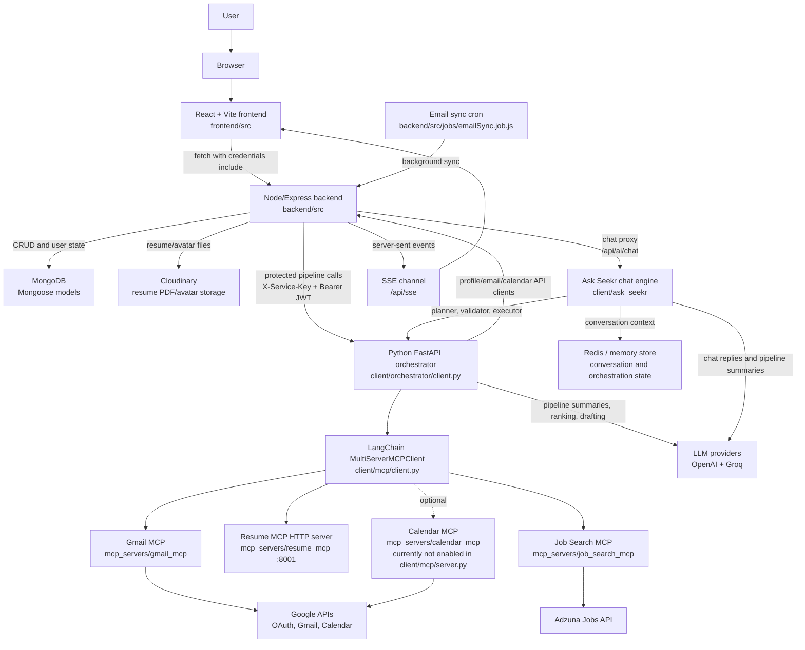

## 2. Repository Ownership Map

```mermaid
flowchart LR
    root["Project root"]

    backend["backend/\nExpress API gateway\nMongoDB models\nOAuth, email, jobs, resume, calendar routes\ncron jobs and SSE"]
    frontend["frontend/\nReact routes, pages, components\nbrowser API calls\nprotected app shell"]
    client["client/\nPython orchestration\nFastAPI pipelines\nMCP wrappers\nLLM, RAG, Ask Seekr, backend clients"]
    mcpServers["mcp_servers/\nstandalone MCP servers\nGmail, resume, job search, calendar"]
    docs["docs/\narchitecture and flow docs"]
    rootFiles["Root files\nREADME.md\nrequirements.txt\npackage.json\nemail.css\nflush_chat_history.py"]

    root --> backend
    root --> frontend
    root --> client
    root --> mcpServers
    root --> docs
    root --> rootFiles

    backend --> backendEntry["src/index.js\nloads env, connects DB, fixes indexes,\nstarts Express and email sync job"]
    backend --> backendApp["src/app.js\nmiddleware, route mounting,\nSSE, 404, global errors"]
    backend --> controllers["controllers/\nHTTP handlers"]
    backend --> services["services/\nbusiness logic and Python pipeline proxy"]
    backend --> models["models/\nUser, Resume, Email, OAuthToken, CalendarEvent"]
    backend --> routes["routes/\n/api/user, /api/auth, /api/jobs,\n/api/emails, /api/calendar, /api/ai,\n/api/resume, /api/profile"]

    frontend --> app["src/App.jsx\nReact Router map"]
    frontend --> pages["pages/\nAuth, Dashboard, Profile, Emails,\nJobs, Settings, AskAI, Resume"]
    frontend --> components["components/\nlayout, common, dashboard, emails,\njobs, profile, resume, auth"]
    frontend --> api["utils/api.js\nall browser-to-backend fetch helpers"]

    client --> fastapi["orchestrator/client.py\nFastAPI endpoints"]
    client --> ask["ask_seekr/\nplanner, validator, executor, memory, RAG"]
    client --> wrappers["wrappers/\nGmail, calendar, resume, job MCP tool wrappers"]
    client --> pyAgents["orchestrator/*_agent.py\nemail, job, resume, calendar pipelines"]
    client --> backendClients["backend_client/\nPython calls back into Express"]
    client --> llmLayer["llm/\nOpenAI, Groq, prompts, job matching"]
    client --> rag["rag/\nembeddings, ingest, retrieve, vector store"]

    mcpServers --> gmail["gmail_mcp\nGmail fetch, parse, draft, send"]
    mcpServers --> resume["resume_mcp\nPDF parse, section extraction, ATS scoring"]
    mcpServers --> job["job_search_mcp\nAdzuna search, categories, skill filter"]
    mcpServers --> calendar["calendar_mcp\nGoogle Calendar event creation"]
```

## 3. Backend Startup And Request Routing

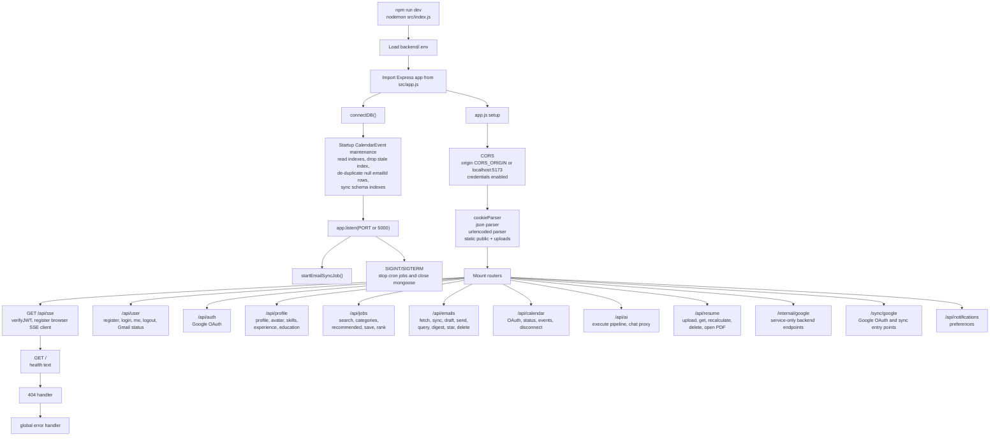

## 4. Frontend Navigation And API Flow

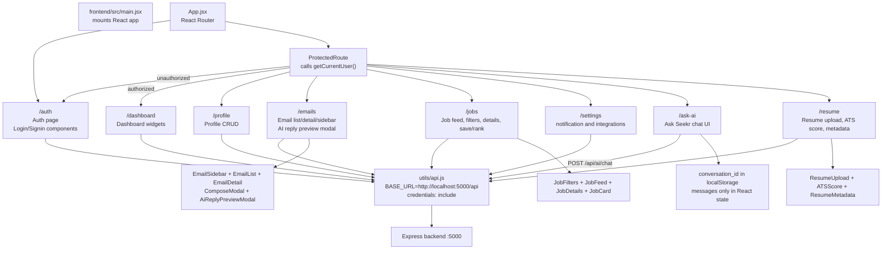

## 5. Authentication And Authorization Flow

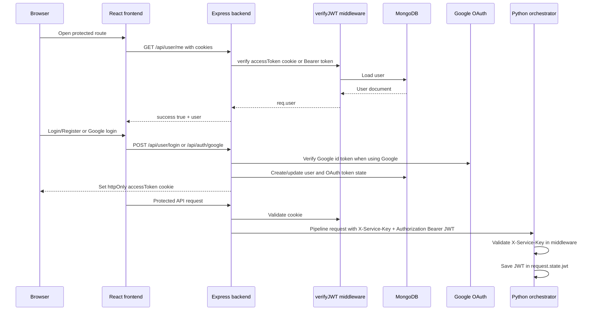

## 6. AI Pipeline Gateway Flow

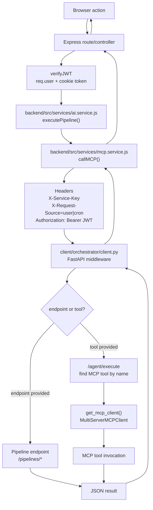

## 7. Ask Seekr Chat Flow

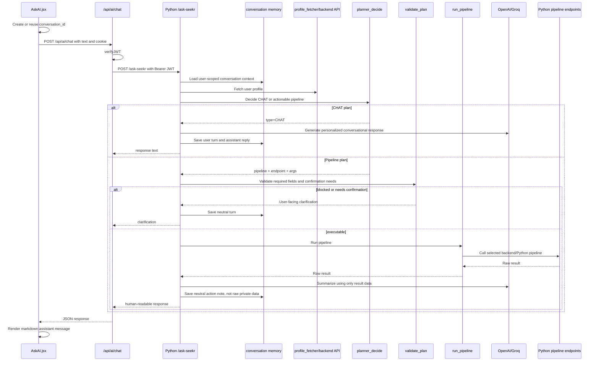

## 8. Resume Upload, Parse, Score, Store Flow

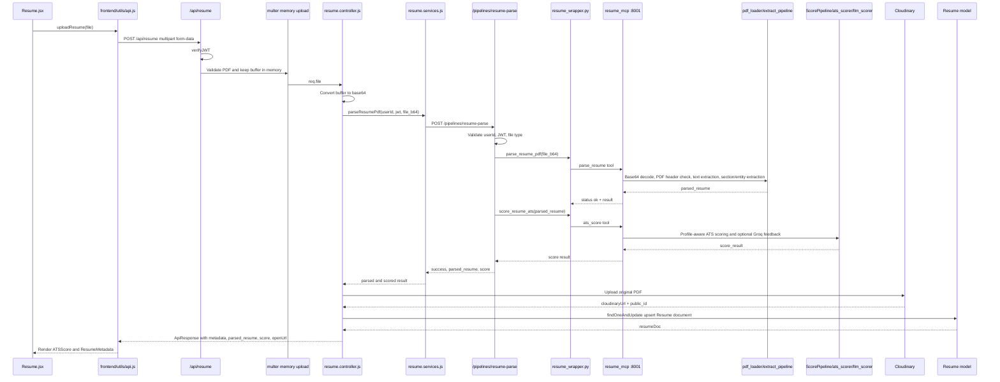

## 9. Resume Recalculation Flow

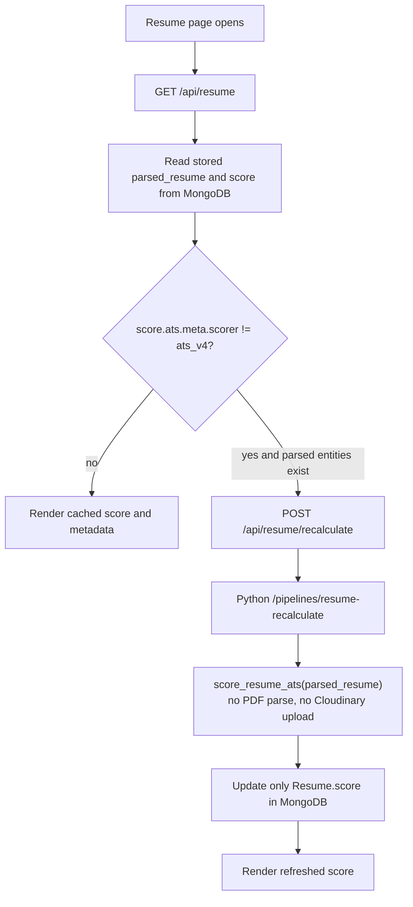

## 10. Job Search And Recommendation Flow

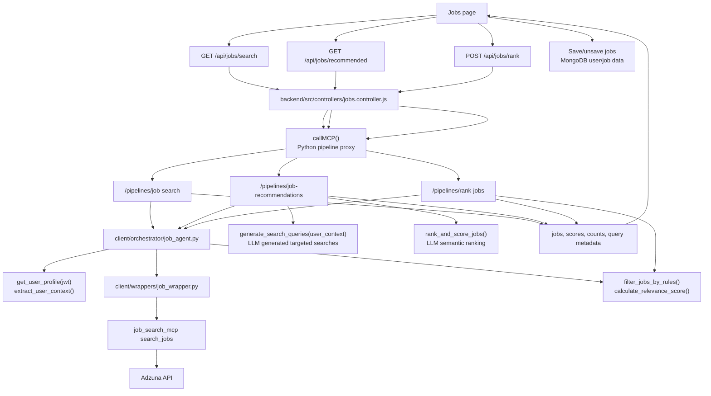

## 11. Gmail Email Sync, Draft, And Send Flow

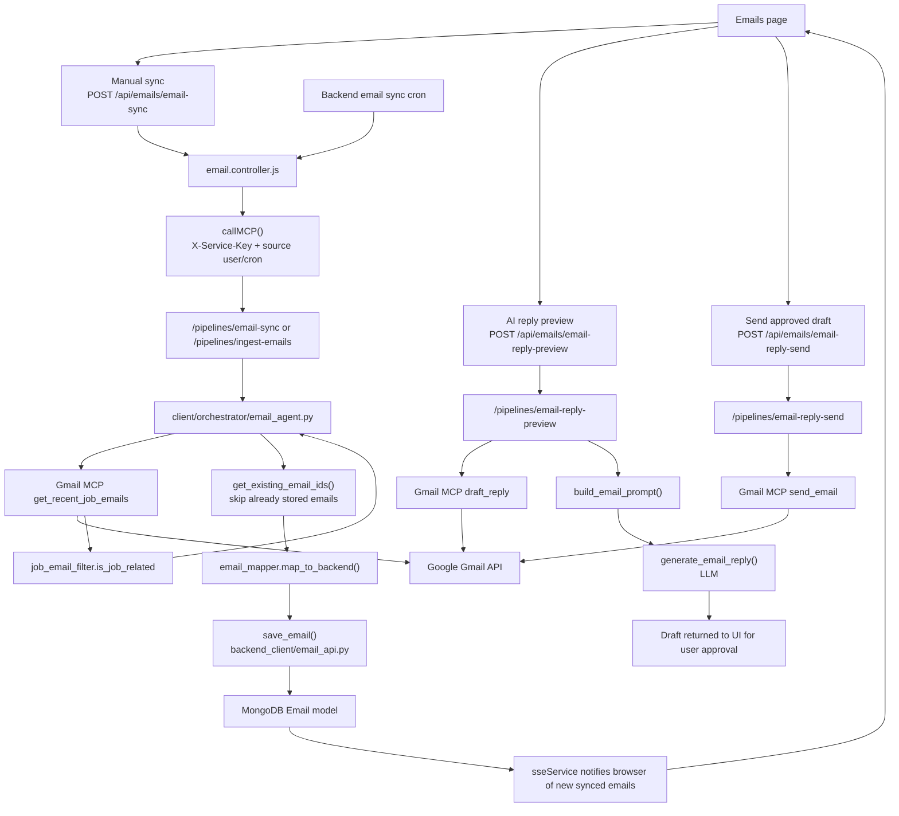

## 12. Calendar Flow

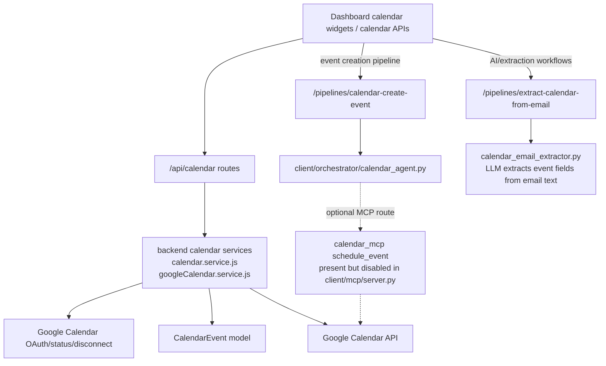

## 13. Data Persistence Flow

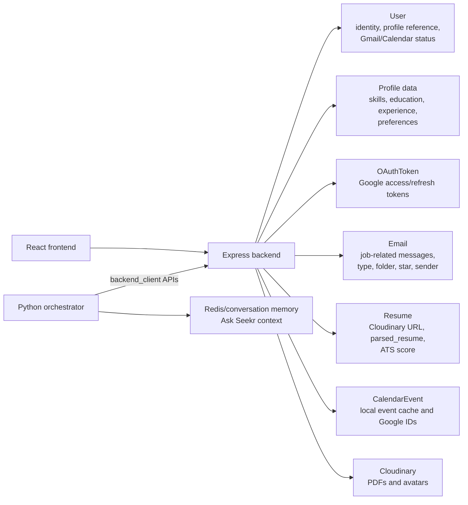

## 14. Active MCP Server Topology

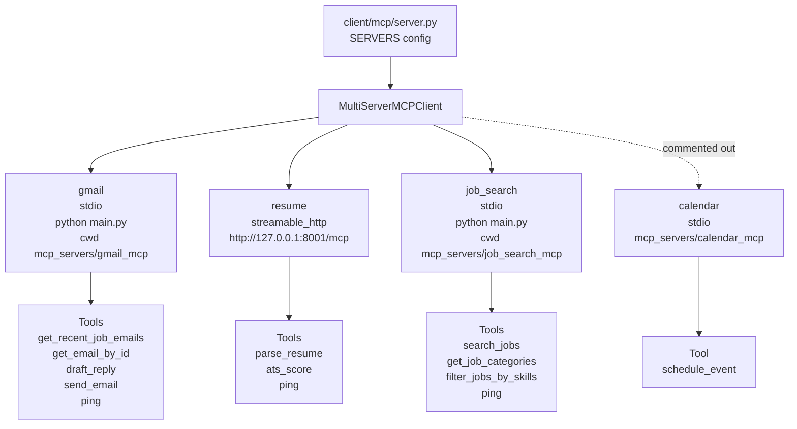

## 15. Main User Journeys

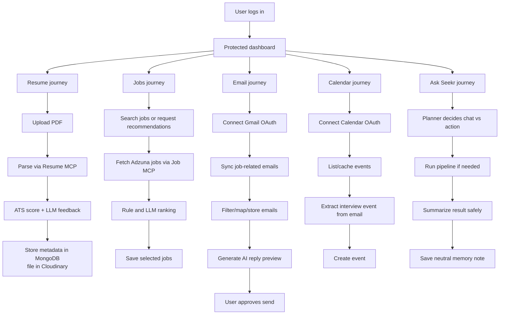

## 16. Important Implementation Notes

- The frontend talks to the backend at `http://localhost:5000/api` with `credentials: "include"`, so auth is cookie-centered in the browser.
- Express validates user requests with `verifyJWT`, then forwards JWTs to Python as Bearer tokens for user-scoped pipelines.
- Python pipeline endpoints require `X-Service-Key`; cron calls also use `X-Request-Source: cron` and `X-User-Id`.
- `client/mcp/server.py` currently enables Gmail, resume, and job search MCP servers. Calendar MCP exists but is commented out there.
- Resume MCP runs as a separate HTTP MCP server on `127.0.0.1:8001/mcp`; Gmail and job search run as stdio subprocess MCP servers.
- Ask Seekr stores conversation context by user/conversation, but after tool execution it stores only a neutral action note, not raw private email/job data.
- `docs/architecture.md`, `docs/agent_flow.md`, and `docs/mcp_contracts.md` are currently empty in this checkout, so this file is the detailed architecture reference generated from source.
